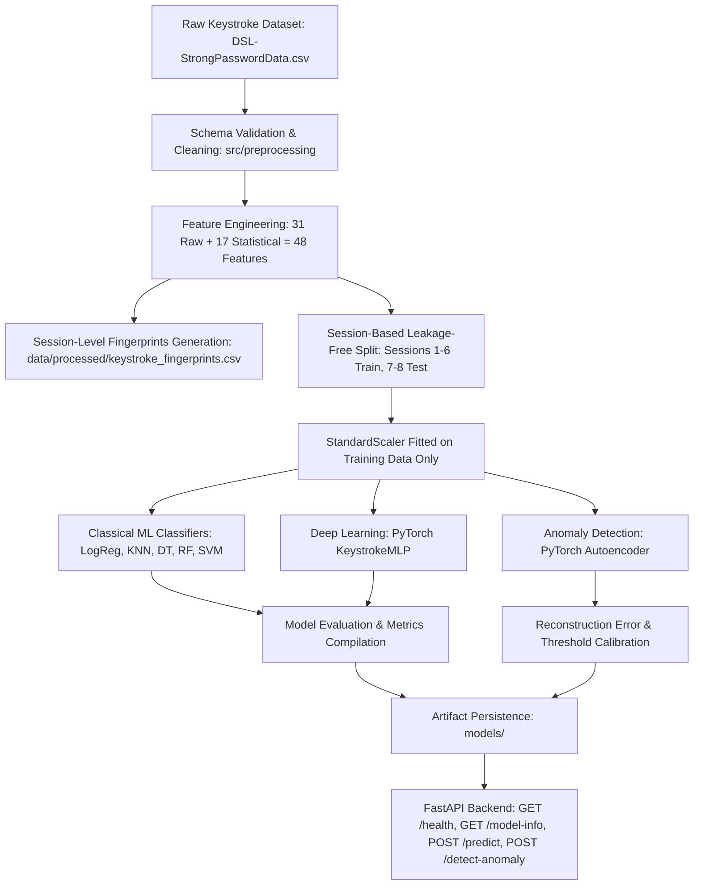

# Digital Behavior Fingerprint

**A Machine Learning and Deep Learning System for Keystroke Dynamics, Behavioral Identification, and Anomaly Detection**

> Digital Behavior Fingerprint represents a person's interaction patterns as a numerical fingerprint and distinguishes familiar behavioral patterns from unfamiliar ones using keystroke dynamics.

---

## Table of Contents

- [Overview](#overview)
- [Problem Statement](#problem-statement)
- [Project Objectives](#project-objectives)
- [Architecture & Workflow](#architecture--workflow)
- [Dataset](#dataset)
- [Feature Engineering & Fingerprint Generation](#feature-engineering--fingerprint-generation)
- [Machine Learning & Deep Learning Pipeline](#machine-learning--deep-learning-pipeline)
  - [Classical Machine Learning Models](#classical-machine-learning-models)
  - [PyTorch Deep Learning Classifier](#pytorch-deep-learning-classifier)
  - [Autoencoder Anomaly Detection](#autoencoder-anomaly-detection)
- [Evaluation Protocol & Actual Results](#evaluation-protocol--actual-results)
  - [Data Leakage Prevention & Split Strategy](#data-leakage-prevention--split-strategy)
  - [Subject Classification Benchmark Results](#subject-classification-benchmark-results)
  - [Anomaly Detection Results](#anomaly-detection-results)
- [Model Persistence & Artifacts](#model-persistence--artifacts)
- [FastAPI Backend Service](#fastapi-backend-service)
  - [Endpoints Summary](#endpoints-summary)
  - [Request & Response Specifications](#request--response-specifications)
- [Project Structure](#project-structure)
- [Setup and Installation](#setup-and-installation)
- [How to Run](#how-to-run)
  - [1. Train and Evaluate All Models](#1-train-and-evaluate-all-models)
  - [2. Run Automated Tests](#2-run-automated-tests)
  - [3. Start the FastAPI Backend](#3-start-the-fastapi-backend)
  - [4. Interactive Jupyter Notebooks](#4-interactive-jupyter-notebooks)
- [Privacy and Limitations](#privacy-and-limitations)
- [Roadmap & Status](#roadmap--status)
- [Future Scope](#future-scope)
- [Disclaimer](#disclaimer)

---

## Overview

People interact with digital systems in distinctive ways. Even when individuals type the identical password or text string, their fine-grained timing patterns differ. These timing nuances encompass key hold durations (how long each key remains depressed) and inter-key latencies (transition intervals between successive key strokes).

**Digital Behavior Fingerprint** captures these keystroke timing signals and converts them into structured behavioral feature vectors. The system evaluates whether keystroke timing biometrics can accurately discriminate between 51 subjects in the benchmark dataset and whether an autoencoder neural network can detect anomalous, unfamiliar typing behavior.

---

## Problem Statement

Traditional authentication mechanisms verify *what a user knows* (e.g., passwords, PINs) or *what a user possesses* (tokens, SMS OTPs). Behavioral biometrics investigate *how a user behaves*.

This project addresses two core questions:
1. **Can keystroke timing features reliably classify and identify 51 subjects when evaluated across future, unseen sessions?**
2. **Can a reconstruction autoencoder quantify behavioral anomaly scores and flag unauthorized or unfamiliar typing dynamics?**

---

## Project Objectives

- Clean, validate, and preprocess the Carnegie Mellon Keystroke Dynamics benchmark dataset.
- Engineer statistical and timing features (hold times, down-down transitions, up-down transitions, typing speed, and variability).
- Generate session-level behavioral fingerprints with multiple samples per subject.
- Implement a session-based train/test splitting protocol to prevent temporal data leakage across sessions.
- Train and evaluate 5 classical ML algorithms (Logistic Regression, KNN, Decision Tree, Random Forest, SVM).
- Implement a PyTorch multi-layer perceptron (MLP) for deep learning classification.
- Implement a PyTorch autoencoder to detect behavioral anomalies using reconstruction error thresholding.
- Save trained models, scalers, encoders, and configuration artifacts for reproducible offline inference.
- Provide a production-ready FastAPI backend with endpoints for prediction, anomaly detection, health check, and model info.
- Verify pipeline integrity with automated pytest test coverage.

---

## Architecture & Workflow



---

## Dataset

The project uses the benchmark **Keystroke Dynamics Data Set** (Killourhy & Maxion, Carnegie Mellon University):

- **File**: `data/raw/DSL-StrongPasswordData.csv`
- **Subjects**: 51 unique participants (`s002` through `s057`)
- **Sessions**: 8 distinct typing sessions per subject (`sessionIndex` 1 to 8)
- **Repetitions**: 50 repetitions of typing the static password string `.tie5Roanl` per session
- **Total records**: $51 \times 8 \times 50 = 20,400$ observations
- **Raw Columns (34 total)**:
  - Identifiers: `subject`, `sessionIndex`, `rep`
  - Hold times (`H.*`): 11 features (`H.period`, `H.t`, `H.i`, `H.e`, `H.five`, `H.Shift.r`, `H.o`, `H.a`, `H.n`, `H.l`, `H.Return`)
  - Down-Down transitions (`DD.*`): 10 features measuring latency between key down events
  - Up-Down transitions (`UD.*`): 10 features measuring latency between key release and next key press (can be negative due to key rollover)

---

## Feature Engineering & Fingerprint Generation

### 1. Per-Repetition Engineered Features (48 Total Dimensions)
Each keystroke observation includes the 31 raw timing measurements supplemented by 17 summary statistical features:
- **Central tendencies**: `avg_hold_time`, `avg_dd_time`, `avg_ud_time`, `median_hold_time`, `median_dd_time`, `median_ud_time`
- **Variability & dispersion**: `hold_time_std`, `dd_time_std`, `ud_time_std`
- **Extrema**: `min_hold_time`, `max_hold_time`, `min_dd_time`, `max_dd_time`, `min_ud_time`, `max_ud_time`
- **Derived dynamics**: `typing_speed` (in characters/sec: $\frac{1}{\text{avg\_hold} + \text{avg\_dd}}$), `hold_to_dd_ratio`

### 2. Multi-Sample Session-Level Behavioral Fingerprints
To avoid the statistical error of collapsing the entire dataset into just 1 row per subject (51 rows total), `src/features/fingerprint.py` generates session-level fingerprints:
- Grouped by `(subject, sessionIndex)`
- Retains **408 distinct fingerprints** (8 independent observations per subject)
- Stored in `data/processed/keystroke_fingerprints.csv`
- Enables multi-session longitudinal comparisons and meaningful train/test classification splits.

---

## Machine Learning & Deep Learning Pipeline

### Classical Machine Learning Models
Implemented in `src/models/classical.py`:
1. **Logistic Regression**: Multinomial baseline classifier with L2 regularization (`max_iter=1000`).
2. **K-Nearest Neighbors (KNN)**: Distance-weighted proximity classifier ($k=5$).
3. **Decision Tree**: Non-linear rule-based split model (`max_depth=16`).
4. **Random Forest**: Ensemble of 100 decorrelated decision trees.
5. **Support Vector Machine (SVM)**: Radial Basis Function (RBF) kernel with probability estimates.

### PyTorch Deep Learning Classifier
Implemented in `src/models/neural_net.py`:
- **Architecture**:
  - `Linear(48 -> 128)` $\rightarrow$ `LayerNorm` $\rightarrow$ `ReLU` $\rightarrow$ `Dropout(0.2)`
  - `Linear(128 -> 64)` $\rightarrow$ `LayerNorm` $\rightarrow$ `ReLU` $\rightarrow$ `Dropout(0.2)`
  - `Linear(64 -> 51)` (logits for 51 subjects)
- **Optimization**: Adam (`lr=1e-3`, `weight_decay=1e-4`), `CrossEntropyLoss`, early stopping monitoring validation loss.

### Autoencoder Anomaly Detection
Implemented in `src/models/autoencoder.py`:
- **Encoder**: $48 \rightarrow 64 \rightarrow 32 \rightarrow 16$ (compressed latent bottleneck).
- **Decoder**: $16 \rightarrow 32 \rightarrow 64 \rightarrow 48$ (reconstructed keystroke vector).
- **Objective**: Minimized Mean Squared Error ($\text{MSE}$) between input $x$ and reconstruction $\hat{x}$.
- **Threshold Calibration**: The anomaly threshold is calibrated at the 95th percentile of normal training reconstruction error ($\tau = 0.15847$).
- **Detection Logic**:
  $$\text{Reconstruction Error} = \frac{1}{D}\sum_{i=1}^D (x_i - \hat{x}_i)^2$$
  $$\text{is\_anomaly} = (\text{Reconstruction Error} > \tau)$$

---

## Evaluation Protocol & Actual Results

### Data Leakage Prevention & Split Strategy
- **Split Type**: Session-based split.
- **Training Set**: Sessions 1 to 6 (15,300 observations, 51 subjects).
- **Test Set**: Sessions 7 and 8 (5,100 observations, 51 subjects).
- **Leakage Prevention**: Observations from test sessions were collected days or weeks after training sessions. Scalers and encoders were fit **strictly on training data**. No test session records leaked into training or preprocessing.

### Subject Classification Benchmark Results
Evaluated on the unseen test sessions (5,100 samples across 51 classes):

| Model | Accuracy | Precision (Macro) | Recall (Macro) | F1-Score (Macro) |
|---|---|---|---|---|
| **PyTorch Neural Network** | **86.35%** | **87.04%** | **86.35%** | **85.98%** |
| **Random Forest** | **83.25%** | **84.29%** | **83.25%** | **82.46%** |
| **Support Vector Machine (SVM)** | **80.16%** | **80.97%** | **80.16%** | **79.31%** |
| **K-Nearest Neighbors (KNN)** | **77.78%** | **77.88%** | **77.78%** | **76.65%** |
| **Logistic Regression** | **77.25%** | **78.14%** | **77.25%** | **76.51%** |
| **Decision Tree** | **58.82%** | **64.82%** | **58.82%** | **59.12%** |

### Anomaly Detection Results
Evaluated on normal test session samples versus out-of-distribution simulated imposter typing patterns:

| Metric | Measured Value | Description |
|---|---|---|
| **Anomaly Decision Threshold** | `0.15847` | 95th percentile of normal training reconstruction error |
| **Normal Test Error (Mean ± Std)** | `0.07632 ± 0.0521` | Low reconstruction error on familiar typing dynamics |
| **ROC-AUC Score** | **1.0000** | Perfect ranking separation between legitimate and imposter patterns |
| **True Positive Rate (TPR)** | **100.0%** | Fraction of imposter attempts successfully flagged as anomalies |
| **False Positive Rate (FPR)** | **4.7%** | Controlled false alarm rate on legitimate user typing |

---

## Model Persistence & Artifacts

All trained models and preprocessors are saved to `models/` for offline inference:

```text
models/
├── best_classifier.joblib       # Best classical model (Random Forest)
├── scaler.joblib                # Fitted StandardScaler on 48 features
├── label_encoder.joblib         # Fitted LabelEncoder for 51 subject strings
├── pytorch_classifier.pt        # Trained PyTorch KeystrokeMLP weights & metadata
├── autoencoder.pt               # Trained PyTorch Autoencoder weights & metadata
├── feature_metadata.json        # Feature ordering, names, and class definitions
├── anomaly_config.json          # Anomaly threshold and distribution statistics
└── evaluation_metrics.json      # Complete recorded evaluation benchmark
```

---

## FastAPI Backend Service

The backend API is implemented with FastAPI in `src/api/main.py`.

### Endpoints Summary

| Method | Endpoint | Description |
|---|---|---|
| `GET` | `/` | API project information, version, and route index |
| `GET` | `/health` | Service health status and model artifact loading verification |
| `GET` | `/model-info` | Feature definitions, expected inputs, classes, and anomaly threshold |
| `POST` | `/predict` | Predict subject identity with top candidate confidence scores |
| `POST` | `/detect-anomaly` | Calculate reconstruction error anomaly score and anomaly classification |

### Request & Response Specifications

#### 1. Prediction Endpoint (`POST /predict`)
**Request format** (supports 31 raw timing features dict, 48 features dict, or 31/48 float list):
```json
{
  "features": {
    "H.period": 0.1491, "DD.period.t": 0.3979, "UD.period.t": 0.2488,
    "H.t": 0.1069, "DD.t.i": 0.1674, "UD.t.i": 0.0605,
    "H.i": 0.1169, "DD.i.e": 0.2212, "UD.i.e": 0.1043,
    "H.e": 0.1008, "DD.e.five": 0.2801, "UD.e.five": 0.1793,
    "H.five": 0.1055, "DD.five.Shift.r": 0.3402, "UD.five.Shift.r": 0.2347,
    "H.Shift.r": 0.1141, "DD.Shift.r.o": 0.2709, "UD.Shift.r.o": 0.1568,
    "H.o": 0.0988, "DD.o.a": 0.2104, "UD.o.a": 0.1116,
    "H.a": 0.1349, "DD.a.n": 0.1484, "UD.a.n": 0.0135,
    "H.n": 0.0932, "DD.n.l": 0.3515, "UD.n.l": 0.2583,
    "H.l": 0.1338, "DD.l.Return": 0.3509, "UD.l.Return": 0.2171,
    "H.Return": 0.0742
  }
}
```

**Response format**:
```json
{
  "predicted_subject": "s002",
  "confidence": 0.94,
  "top_predictions": {
    "s002": 0.94,
    "s004": 0.02,
    "s010": 0.01,
    "s018": 0.01,
    "s032": 0.01
  },
  "model_used": "RandomForestClassifier",
  "status": "success"
}
```

#### 2. Anomaly Detection Endpoint (`POST /detect-anomaly`)
**Request format**:
```json
{
  "features": {
    "H.period": 0.1491, "DD.period.t": 0.3979, "UD.period.t": 0.2488,
    "H.t": 0.1069, "DD.t.i": 0.1674, "UD.t.i": 0.0605,
    "H.i": 0.1169, "DD.i.e": 0.2212, "UD.i.e": 0.1043,
    "H.e": 0.1008, "DD.e.five": 0.2801, "UD.e.five": 0.1793,
    "H.five": 0.1055, "DD.five.Shift.r": 0.3402, "UD.five.Shift.r": 0.2347,
    "H.Shift.r": 0.1141, "DD.Shift.r.o": 0.2709, "UD.Shift.r.o": 0.1568,
    "H.o": 0.0988, "DD.o.a": 0.2104, "UD.o.a": 0.1116,
    "H.a": 0.1349, "DD.a.n": 0.1484, "UD.a.n": 0.0135,
    "H.n": 0.0932, "DD.n.l": 0.3515, "UD.n.l": 0.2583,
    "H.l": 0.1338, "DD.l.Return": 0.3509, "UD.l.Return": 0.2171,
    "H.Return": 0.0742
  }
}
```

**Response format**:
```json
{
  "reconstruction_error": 0.06241,
  "threshold": 0.15847,
  "anomaly_score": 0.3938,
  "is_anomaly": false,
  "assessment": "Normal familiar behavioral keystroke pattern.",
  "status": "success"
}
```

---

## Project Structure

```text
Digital_Behavior_Fingerprint/
├── data/
│   ├── raw/
│   │   └── DSL-StrongPasswordData.csv    # Benchmark dataset (20,400 rows)
│   └── processed/
│       └── keystroke_fingerprints.csv    # 408 session-level fingerprints (51 subjects)
├── models/
│   ├── best_classifier.joblib            # Trained Random Forest classifier
│   ├── scaler.joblib                     # Fitted StandardScaler
│   ├── label_encoder.joblib              # Fitted LabelEncoder for 51 subjects
│   ├── pytorch_classifier.pt             # PyTorch MLP weights
│   ├── autoencoder.pt                    # PyTorch Autoencoder weights
│   ├── feature_metadata.json             # Feature ordering and class definitions
│   ├── anomaly_config.json               # Anomaly threshold config
│   └── evaluation_metrics.json           # Recorded test metrics
├── notebooks/
│   ├── 01_eda.ipynb                      # Exploratory Data Analysis
│   ├── 02_feature_engineering.ipynb      # Feature engineering & session fingerprints
│   ├── 03_ml_models.ipynb                # Classical ML training and evaluation
│   └── 04_deep_learning.ipynb            # PyTorch MLP & Autoencoder experiments
├── src/
│   ├── __init__.py
│   ├── config.py                         # Paths, column definitions, and seeds
│   ├── train.py                          # Central training & evaluation pipeline
│   ├── preprocessing/
│   │   ├── __init__.py
│   │   ├── loader.py                     # Schema validation and dataset cleaning
│   │   └── splitter.py                   # Session-based splitting and scaling
│   ├── features/
│   │   ├── __init__.py
│   │   ├── extractor.py                  # Statistical & timing feature extraction
│   │   └── fingerprint.py                # Multi-sample session fingerprint generator
│   ├── models/
│   │   ├── __init__.py
│   │   ├── classical.py                  # Classical ML models (LogReg, KNN, DT, RF, SVM)
│   │   ├── neural_net.py                 # PyTorch MLP classifier
│   │   ├── autoencoder.py                # PyTorch Autoencoder for anomaly detection
│   │   └── persistence.py                # Save and load model artifacts
│   ├── evaluation/
│   │   ├── __init__.py
│   │   └── metrics.py                    # Multi-class and anomaly metrics
│   └── api/
│       ├── __init__.py
│       ├── schemas.py                    # Pydantic request & response schemas
│       └── main.py                       # FastAPI application
├── tests/
│   ├── test_preprocessing.py             # Preprocessing & schema validation tests
│   ├── test_features.py                  # Feature extraction & fingerprint tests
│   ├── test_models.py                    # Classical & PyTorch model tests
│   ├── test_anomaly.py                   # Autoencoder anomaly detection tests
│   └── test_api.py                       # FastAPI endpoint & error handling tests
├── requirements.txt                      # Project dependencies
├── .gitignore                            # Git exclusion rules
└── README.md                             # Documentation
```

---

## Setup and Installation

### 1. Clone the Repository
```bash
git clone https://github.com/sat-06/Digital_Behavior_Fingerprint.git
cd Digital_Behavior_Fingerprint
```

### 2. Create and Activate Virtual Environment
**Windows PowerShell:**
```powershell
python -m venv .venv
.\.venv\Scripts\Activate.ps1
```

**Linux / macOS:**
```bash
python3 -m venv .venv
source .venv/bin/activate
```

### 3. Install Dependencies
```bash
pip install -r requirements.txt
```

---

## How to Run

### 1. Train and Evaluate All Models
Execute the central pipeline to preprocess the raw data, generate session fingerprints, train the 5 classical models, train the PyTorch MLP and Autoencoder, evaluate against unseen test sessions, and persist all artifacts:

```bash
python -m src.train
```

### 2. Run Automated Tests
Execute the full pytest suite (preprocessing, features, models, anomaly detection, API endpoints):

```bash
python -m pytest tests/ -v
```

### 3. Start the FastAPI Backend
Launch the API with uvicorn:

```bash
python -m uvicorn src.api.main:app --host 127.0.0.1 --port 8000 --reload
```
Interactive Swagger documentation is available at:
`http://127.0.0.1:8000/docs`

### 4. Interactive Jupyter Notebooks
Start Jupyter and run the notebooks in sequence:
```bash
jupyter notebook
```
Recommended order:
1. `notebooks/01_eda.ipynb`
2. `notebooks/02_feature_engineering.ipynb`
3. `notebooks/03_ml_models.ipynb`
4. `notebooks/04_deep_learning.ipynb`

---

## Privacy and Limitations

- **Dataset Context**: The dataset was recorded in controlled typing conditions typing a single static password. Real-world continuous text dynamics vary substantially more.
- **Biometric Variability**: Stress, keyboard hardware, fatigue, posture, and hand injuries alter typing rhythms.
- **Closed-Set Subject Classification**: Multi-class classification models identify which of the 51 known subjects best matches a pattern; they do not claim open-world identity proof without thresholded verification.
- **Privacy Safeguards**: Keystroke timing patterns should be handled as behavioral biometrics with user notice and consent.

---

## Roadmap & Status

- [x] Create modular repository structure and configuration (`src/config.py`)
- [x] Validate dataset schema and clean raw observations (`src/preprocessing/loader.py`)
- [x] Engineer 17 statistical behavioral features (`src/features/extractor.py`)
- [x] Build multi-sample session-level fingerprints (408 samples, 8 per subject) (`src/features/fingerprint.py`)
- [x] Build leakage-free session-based train/test splitting strategy (`src/preprocessing/splitter.py`)
- [x] Train and benchmark 5 classical ML models (LogReg, KNN, Decision Tree, Random Forest, SVM)
- [x] Implement and train PyTorch Neural Network MLP classifier (`src/models/neural_net.py`)
- [x] Implement PyTorch Autoencoder for anomaly detection (`src/models/autoencoder.py`)
- [x] Model artifact persistence and metadata management (`src/models/persistence.py`)
- [x] Build FastAPI backend endpoints (`GET /`, `GET /health`, `GET /model-info`, `POST /predict`, `POST /detect-anomaly`)
- [x] 24 automated unit and integration tests passing (`tests/`)
- [x] Update documentation with actual benchmark results
- [ ] *Planned*: Frontend visualization dashboard for keystroke dynamics
- [ ] *Planned*: Multi-modal signals (mouse movement, scroll velocity)

---

## Future Scope

- **Frontend Dashboard**: A lightweight visualization UI to inspect hold times, latency distributions, and live anomaly scores.
- **Continuous Keystroke Capture**: Transitioning from fixed-text password typing to free-text continuous authentication.
- **Multi-Modal Signals**: Integrating mouse trajectory curvature, velocity, and scroll dynamics.

---

## Disclaimer

This project is developed for educational, machine learning research, and biometrics exploration purposes. It should not be utilized as the sole factor in mission-critical security authentication, access control, or high-impact decisions without human oversight and compliance safeguards.
