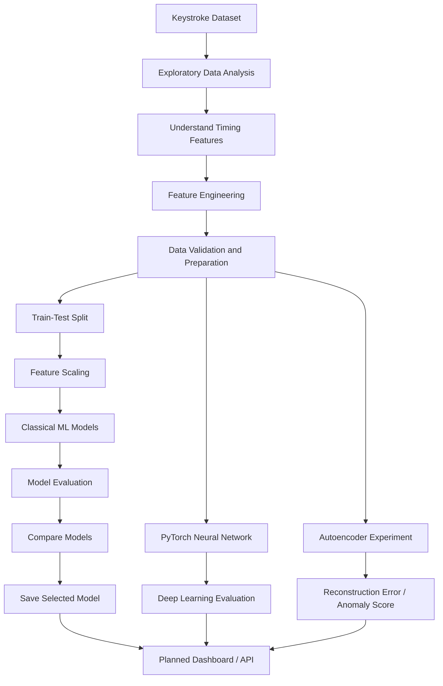
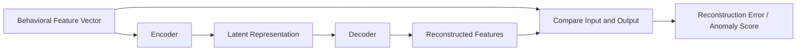

# Digital Behavior Fingerprint

**A Machine Learning Project for Keystroke Dynamics, Behavioral Identification, and Anomaly Detection**

> Digital Behavior Fingerprint explores whether a person's interaction patterns can be represented as a numerical fingerprint and used to distinguish familiar behavioral patterns from unfamiliar ones.

---

## Table of Contents

- [Overview](#overview)
- [Problem Statement](#problem-statement)
- [Objectives](#project-objectives)
- [How It Works](#how-it-works)
- [Process Flow](#process-flow)
- [Current Scope](#current-scope-version-1)
- [Dataset](#dataset)
- [Feature Engineering](#feature-engineering)
- [Machine Learning Approach](#machine-learning-approach)
- [Deep Learning and Anomaly Detection](#deep-learning-and-anomaly-detection)
- [Technology Stack](#technology-stack)
- [Project Structure](#project-structure)
- [Setup and Installation](#setup-and-installation)
- [Running the Project](#running-the-project)
- [Evaluation Metrics](#evaluation-metrics)
- [Privacy and Limitations](#privacy-and-limitations)
- [Roadmap](#roadmap)
- [Future Scope](#future-scope)
- [Disclaimer](#disclaimer)

## Overview

People interact with digital systems in different ways. Even when two people type the same password or text, their timing patterns may differ. These differences can include how long keys are held and the time between successive key events.

**Digital Behavior Fingerprint** is an exploratory machine learning project that studies these patterns and converts them into numerical features. The project begins with **keystroke dynamics** and uses classical machine learning to investigate whether those features can distinguish between subjects represented in a dataset.

Later stages are planned to explore deep learning and anomaly detection, followed by a dashboard for visualizing behavioral features and model outputs.

The initial version uses an existing dataset for offline experimentation. It does not yet continuously monitor real users or provide production-grade authentication.

## Problem Statement

Traditional authentication methods, such as passwords, mainly verify what a user knows. Behavioral biometrics investigate how a person interacts with a system.

This project investigates the question:

**Can timing patterns in keystroke data provide useful features for distinguishing the subjects represented in a dataset?**

The project measures the performance of machine learning approaches, examines their limitations, and explores whether a learned representation can help identify behavior that differs from patterns seen during training.

## Project Objectives

- Explore and understand a keystroke dynamics dataset.
- Clean and organize timing data for analysis.
- Engineer numerical features that summarize typing behavior.
- Train and compare classical machine learning models.
- Evaluate models using suitable classification metrics and confusion matrices.
- Learn neural network fundamentals using PyTorch.
- Explore anomaly detection using an autoencoder.
- Build a dashboard to visualize features, model predictions, and evaluation results.
- Keep the implementation modular so future interaction signals can be added.

## How It Works

1. **Load data:** Begin with an existing keystroke dataset.
2. **Explore the data:** Inspect columns, data types, missing values, distributions, and subject-level differences.
3. **Engineer features:** Summarize raw timing measurements into numerical behavioral features.
4. **Prepare the data:** Select inputs and labels, split data appropriately, and scale features when required.
5. **Train models:** Apply classification algorithms to predict the subject label.
6. **Evaluate:** Compare predictions with known labels using multiple metrics.
7. **Explore deep learning:** Build a neural network and investigate reconstruction-based anomaly detection.
8. **Visualize:** Present relevant features, model results, and experiments in a dashboard.

## Process Flow



*This diagram describes the planned workflow. Mark stages complete only after implementation and testing.*

## Current Scope: Version 1

Version 1 focuses on **keystroke dynamics only**. It uses timing measurements associated with key events to explore behavioral differences between subjects. Initial work is performed offline using a public dataset; live data collection and real-time inference are not part of the initial scope.

### In scope
- Dataset exploration
- Keystroke timing feature analysis
- Feature engineering
- Classical ML classification experiments
- Model evaluation and comparison
- Initial deep learning experiments

### Not yet in scope
- Live keyboard capture
- Mouse movement analysis
- Scroll and navigation tracking
- Production authentication
- Claims of reliable real-world identity verification

## Dataset

The project begins with the **Keystroke Dynamics Benchmark Data Set**, available on Kaggle:

[Open the dataset on Kaggle](https://www.kaggle.com/datasets/carnegiecylab/keystroke-dynamics-benchmark-data-set)

The dataset contains repeated typing measurements from multiple subjects. The local CSV filename and exact columns may vary by download, so use the file and schema present in your repository.

Typical column categories include:

- `subject`: subject label for supervised classification.
- `sessionIndex`: session-related identifier.
- `rep`: repetition number.
- `H.*`: key hold-time measurements.
- `DD.*`: timing measurements between key-down events.
- `UD.*`: timing measurements between a key-up event and a subsequent key-down event.

Check the dataset documentation before relying on the precise interpretation or units of any individual feature.

### Data handling

- Keep the original dataset in `data/raw/`.
- Store derived datasets in `data/processed/`.
- Do not commit sensitive or personally collected behavioral data.
- Record the dataset source and preprocessing decisions.

## Feature Engineering

Raw timing measurements can be transformed into a compact numerical representation of typing behavior.

Potential features include:
- Mean timing values
- Median timing values
- Standard deviation and other variability measures
- Minimum and maximum timing values
- Summary statistics for hold-time and inter-key timing groups

Select features after inspecting the dataset and validating what each column represents.

**Important experimental consideration:** aggregating every record for a subject into one row leaves only one sample per subject. That is generally insufficient for a meaningful train/test classification experiment. Instead, retain multiple samples per subject, for example by creating one feature vector per session or per suitable group of repetitions.

When evaluating generalization, split data by session or repetition where appropriate. Avoid allowing highly similar or related records to appear in both training and testing sets, as this can produce overly optimistic results.

## Machine Learning Approach

The planned classical ML experiments include:

| Model | Purpose |
|---|---|
| Logistic Regression | Establish a baseline classifier |
| K-Nearest Neighbors (KNN) | Compare users based on feature-space proximity |
| Decision Tree | Explore rule-based splits in behavioral features |
| Random Forest | Evaluate an ensemble of decision trees |
| Support Vector Machine (SVM) | Explore classification using decision boundaries |
| K-Means | Explore unsupervised grouping without using subject labels to form clusters |
| PCA | Reduce feature dimensions for visualization and exploration |

These methods serve different purposes: classification models use subject labels, K-Means is unsupervised, and PCA is primarily a dimensionality-reduction technique.

## Deep Learning and Anomaly Detection

After establishing classical ML baselines, the project plans to explore deep learning with **PyTorch**.

### Neural Network

A feed-forward neural network will be trained to learn relationships between engineered timing features and subject labels. Its performance will be compared with classical ML baselines using the same evaluation protocol.

### Autoencoder

An autoencoder learns to reconstruct its input. In a future experiment, it may be trained on selected behavioral samples and use reconstruction error as an anomaly score.



An anomaly score indicates how different a sample is from what the model learned to reconstruct. It does **not**, by itself, prove that a sample belongs to an unauthorized user. Threshold selection and validation on suitable data are required.

## Technology Stack

| Technology | Planned use |
|---|---|
| Python | Main programming language |
| Pandas | Data loading, transformation, and analysis |
| NumPy | Numerical operations |
| Matplotlib and Seaborn | Exploratory plots and visualizations |
| scikit-learn | Classical ML models, preprocessing, and evaluation |
| PyTorch | Neural networks and autoencoder experiments |
| Jupyter Notebook | Interactive experimentation |
| FastAPI | Planned model-serving API |
| WebSockets | Potential real-time communication for a future live-data version |
| PostgreSQL | Potential storage for structured session and inference data |
| HTML, CSS, JavaScript or React | Planned dashboard interface |

The API, database, WebSocket, and frontend components are planned extensions; their presence in this list does not mean they are already implemented.

## Project Structure

```text
Digital_Behavior_Fingerprint/
├── data/
│   ├── raw/                     # Original dataset
│   └── processed/               # Derived datasets and fingerprints
├── notebooks/
│   ├── 01_eda.ipynb             # Exploratory data analysis
│   ├── 02_feature_engineering.ipynb
│   ├── 03_ml_models.ipynb       # Classical ML experiments
│   └── 04_deep_learning.ipynb   # Planned PyTorch experiments
├── src/
│   ├── preprocessing/           # Reusable preprocessing logic
│   ├── features/                # Feature engineering logic
│   ├── models/                  # Model definitions and training
│   └── evaluation/              # Evaluation utilities
├── models/                      # Saved trained models
├── app/                         # Planned API or dashboard
├── requirements.txt
└── README.md
```

The structure may evolve as reusable code is moved out of notebooks and into `src/`.

## Setup and Installation

### 1. Clone the repository

```bash
git clone https://github.com/sat-06/Digital_Behavior_Fingerprint.git
cd Digital_Behavior_Fingerprint
```

### 2. Create and activate a virtual environment

**Windows PowerShell:**

```powershell
py -3.13 -m venv .venv
.\.venv\Scripts\Activate.ps1
```

If PowerShell blocks activation, run the following in that terminal and activate again:

```powershell
Set-ExecutionPolicy -Scope Process -ExecutionPolicy Bypass
.\.venv\Scripts\Activate.ps1
```

### 3. Install dependencies

If `requirements.txt` contains the current project dependencies:

```bash
pip install -r requirements.txt
```

If dependencies have not yet been recorded, install the initial notebook packages:

```bash
pip install pandas numpy matplotlib seaborn scikit-learn jupyter
```

Install PyTorch when starting the deep learning stage, using the instructions appropriate for your operating system and hardware at [the official PyTorch website](https://pytorch.org/get-started/locally/).

### 4. Add the dataset

Download the dataset from Kaggle and place the CSV file in `data/raw/`. Update notebook file paths if your downloaded filename differs from the one used in the notebook.

### 5. Start Jupyter

```bash
jupyter notebook
```

Run notebooks in order, checking that each stage produces the expected outputs.

## Running the Project

Recommended development order:

1. `01_eda.ipynb` — inspect and understand the raw data.
2. `02_feature_engineering.ipynb` — create and validate behavioral features.
3. `03_ml_models.ipynb` — prepare the dataset, train classifiers, and compare results.
4. `04_deep_learning.ipynb` — implement and evaluate neural-network experiments.
5. Move stable, reusable logic into `src/`.
6. Build the planned API and dashboard after the modeling pipeline is validated.

## Evaluation Metrics

For supervised subject classification, evaluate models using:

- **Accuracy:** fraction of predictions that are correct.
- **Precision:** fraction of predicted instances of a class that are correct.
- **Recall:** fraction of actual instances of a class that are identified.
- **F1-score:** harmonic mean of precision and recall.
- **Confusion matrix:** shows correct and incorrect predictions by class.

Because this is a multi-subject problem, inspect per-class results and macro-averaged metrics rather than relying on accuracy alone.

Use a split strategy that matches the intended use case. If the goal is to generalize to a later session, keep sessions separated between training and testing. Fit scalers and other learned preprocessing steps on training data only, then apply the fitted transformations to the test data.

For clustering, use suitable unsupervised analysis and visual inspection; classification accuracy is not directly interchangeable with clustering quality.

## Privacy and Limitations

- Keystroke patterns can be behavioral biometric data and may be sensitive.
- The initial project uses a downloaded dataset for offline experimentation.
- Results on a benchmark dataset do not guarantee performance on other keyboards, devices, environments, or populations.
- Timing can vary with fatigue, stress, device latency, keyboard layout, and other conditions.
- A model prediction is not proof of a person's identity.
- Any future live collection should require appropriate notice and consent, minimize collection, protect stored data, and provide a clear retention policy.
- This project is educational and experimental, not a production security or authentication system.

## Roadmap

- [x] Create initial repository structure
- [x] Select a keystroke dynamics dataset
- [ ] Complete exploratory data analysis
- [ ] Validate feature definitions and feature engineering
- [ ] Build a leakage-aware train/test evaluation strategy
- [ ] Train and compare classical ML models
- [ ] Save and document model results
- [ ] Implement a neural network in PyTorch
- [ ] Experiment with an autoencoder for anomaly scoring
- [ ] Move stable logic into reusable source modules
- [ ] Build an API for model inference
- [ ] Create a dashboard for visualizing results
- [ ] Explore additional signals such as mouse movement, scrolling, and navigation, subject to privacy and consent requirements

Update this checklist as each stage is completed and verified.

## Future Scope

Possible extensions after the keystroke-only version include:


- Mouse movement speed, distance, and direction-change features
- Scroll velocity and direction patterns
- Page dwell time and navigation transitions
- Session duration and idle-time summaries
- Combining multiple behavioral signal types
- A dashboard showing feature distributions, model metrics, and anomaly scores
- Carefully validated, consent-based real-time inference

These are future possibilities, not claims about the current implementation.

## Disclaimer

This project is intended for learning, experimentation, and research into machine learning and behavioral data. It should not be used as the sole basis for authentication, surveillance, disciplinary action, or other high-impact decisions. Any practical deployment would require appropriate consent, security safeguards, bias and robustness evaluation, and human oversight.
